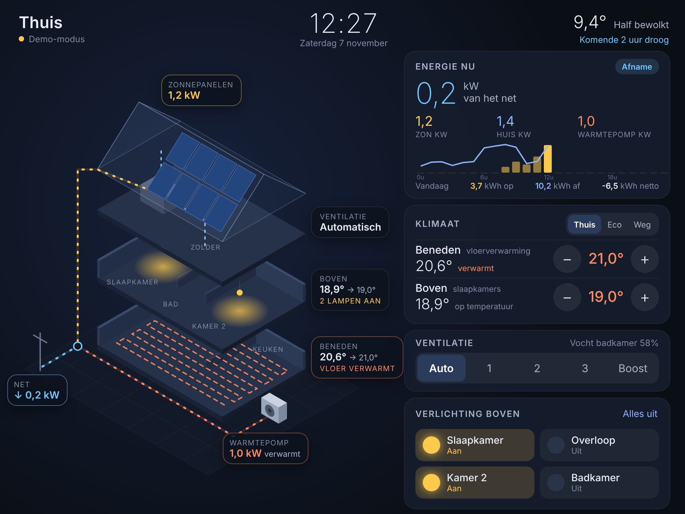

# Thuis: wandpaneel op een oude iPad

Een oude iPad (4e generatie, iOS 10.3.3) als mooi, rustig bedieningspaneel aan de muur. Er staat een opengewerkt 3D-huis op met live energie, verwarming, aircos, ventilatie, verlichting en screens.

## Wat staat er in deze map

| Pad | Inhoud |
|---|---|
| [`dashboard/`](dashboard) | Werkend ontwerp (HTML/CSS/ES5-JS), gemaakt voor oude iPads (1024×768 punten, werkt vanaf iOS 9 Safari). Draait nu in **demo-modus** met nepdata |
| [`docs/01-ipad-onderzoek.md`](docs/01-ipad-onderzoek.md) | Welke iPad het is (iPad 4), sneller maken, jailbreak met Socket + Procyon, accu-veiligheid en ophangen |
| [`docs/02-architectuur.md`](docs/02-architectuur.md) | Hoe alles koppelt via Home Assistant, per apparaat |
| [`docs/03-upgrades.md`](docs/03-upgrades.md) | Wat je nog meer kunt toevoegen (energie, klimaat, veiligheid) |
| [`docs/04-stappenplan.md`](docs/04-stappenplan.md) | **Stappenplan zo goedkoop mogelijk**: kosten per onderdeel, jailbreak stap voor stap, Home Assistant, op afstand (Tailscale) |

## Het ontwerp in het kort
- **Links: de woning op maat**, getekend uit het SketchUp-model (verbouwing zolder). Het huis is opengewerkt: de verdiepingen en het dak zweven los, zodat je erin kijkt.
  - de topgevel in oranje gevelsteen met het zolderraam, en het felszink dak met 6 zonnepanelen
  - de 2e verdieping (zolder) met de LUUMR-lampen (ze gloeien als ze aan staan) en de technische ruimte met de Orcon-unit, het buffervat en het boilervat
  - de 1e verdieping met de radiatoren
  - de begane grond met de vloerverwarming (oranje als hij aan staat) en de Honeywell-thermostaat
  - de Weheat Blackbird en de LG-buitenunit op het grinddak van de uitbouw, en de aansluiting op het net aan de straat
  - de LG-airco binnenunits in slaapkamer 1, 4 en 5 (een blauwe of oranje luchtstroom als ze koelen of verwarmen)
  - Bewegende lijnen tonen de stroom: geel voor zon, groen voor teruglevering, blauw voor afname en oranje voor de warmtepomp. Een blauwe stippellijn toont de ventilatie naar het dak.
- **Rechts**: kaarten om te bedienen:
  - Energie nu, met daggrafiek
  - Klimaat, met tabbladen *Verwarming* (Honeywell-thermostaat, Thuis/Eco/Weg en Weheat-aanvoer/COP) en *Airco* (3 LG's: stand en temperatuur)
  - Ventilatie Orcon (Auto/1/2/3/Boost)
  - Lampen 2e verdieping / Screens (Somfy ▲ my ▼)
- **Boven**: klok, datum, buitentemperatuur en de Buienradar-verwachting.
- Tik je op een verdieping in het huis, dan licht de bijbehorende kaart op. Na 2 minuten zonder aanraking dimt het scherm naar een grote klok.
- Grote knoppen (≥ 42 px), donker thema en weinig animatie, zodat het soepel blijft op de A5-chip.

## Bekijken
Open `dashboard/index.html` in een browser (op een pc: venster op 1024×768), of op de iPad via een webserver.

## Plan
1. ✅ Opzet, onderzoek en ontwerp (deze map)
2. ✅ Woning op maat uit het SketchUp-model; Weheat, Orcon en LUUMR uitgezocht
   ✅ Aircos (LG), screens (Somfy) en buitenunits op het uitbouwdak toegevoegd
   ✅ Honeywell heeft wifi, Somfy is io, screens bij slaapkamer 1, 3 en 4 (zuidzijde)
   ⏳ Nog open: merk van de slimme schakelaar naast de Situo, welke Honeywell-app/HomeKit-code
3. iPad jailbreaken (Socket + Procyon) en Home Assistant installeren: zie [docs/04-stappenplan.md](docs/04-stappenplan.md)
4. Koppelen, daarna `config.js` op `mode: 'homeassistant'`
5. iPad inrichten (Begeleide toegang, slimme stekker voor de lader) en ophangen
